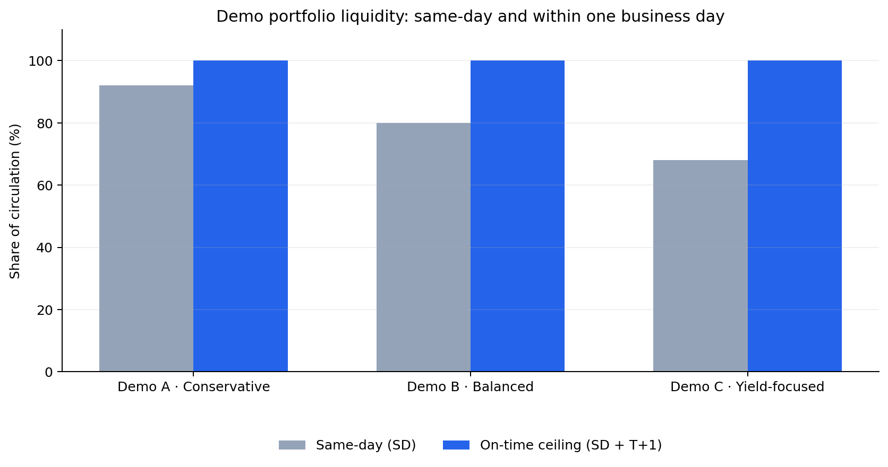
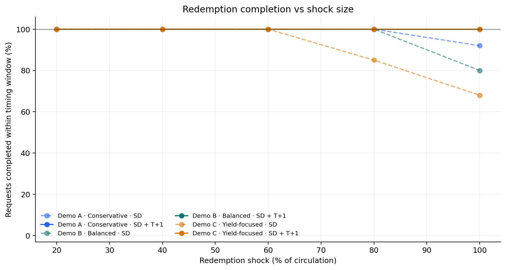
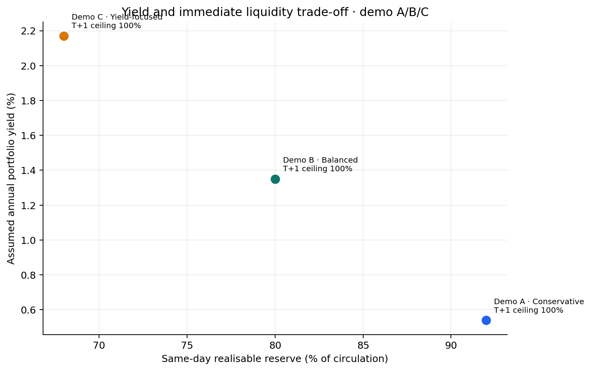
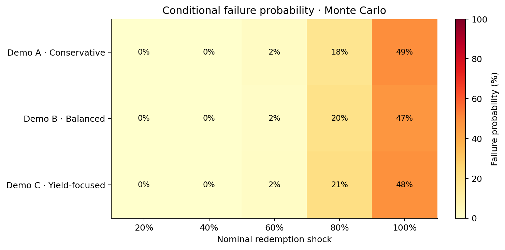

# 稳定币储备与 T+1 兑付韧性

FTEC5510 Advanced Financial Infrastructure · Group 8

本项目用可复现的情景分析和蒙特卡洛模拟，比较 demo 储备组合在赎回冲击下的同日流动性、一个工作日内兑付能力与收益率，并展示 FCFS 和 pro-rata 如何分配有限的同日资金。

> **组合标签说明：** 本仓库 demo 的 A/B/C 是现金与一年内政府债券的 80/20、50/50、20/80 配置；它们与《Reserve Portfolio Design》报告中的 A–E 完全不同。下文结果只针对 demo A/B/C。

## 本轮完成内容

- 将 on-time 口径改为 SD（同日）+ T+1（下一个工作日）累计可变现能力；同日金额仍单独保留作诊断。
- 实现 FCFS（先到先得）和 pro-rata（按请求比例分配）规则。规则分配同日流动性，SD 后尚未支付的请求仍可能在 T+1 内完成。
- 扩展情景矩阵至 3 个组合 × 5 档冲击 × 2 种规则，共 30 行；另输出 90 行示例持有人分配明细。
- 生成 4 张结果图；运行测试套件，9 项测试全部通过。

## 当前 demo 结果

| Demo 组合 | 现金 / 一年内国债 | SD 可用 | SD + T+1 上限 | 假设年化收益 | 80% 冲击下 MC 失败概率* |
|---|---:|---:|---:|---:|---:|
| A · 保守 | 80% / 20% | 92% | 100% | 0.54% | 17.5% |
| B · 中性 | 50% / 50% | 80% | 100% | 1.35% | 19.5% |
| C · 收益导向 | 20% / 80% | 68% | 100% | 2.17% | 20.9% |

确定性情景下，三个 demo 组合都能覆盖最多 100% 流通量的请求；超过同日可用额的部分依赖 T+1。*失败概率是给定名义冲击后的条件概率，使用每情景 1,000 次对数正态抽样（`sigma = 0.25`、固定随机种子），不是无条件违约概率。

## 结果图表

### 同日流动性与一工作日上限



### 赎回冲击下的完成率与失败点

虚线显示同日完成率，实线显示 SD+T+1 完成率。当前 T+1 参数假设使三个组合的一工作日上限均为 100%；组合间的差异主要体现在同日流动性。



### 收益率—流动性权衡

横轴使用**同日**可变现比例，以保留组合之间的即时流动性差异；点旁标注的一工作日上限均为 100%。



### 蒙特卡洛失败概率



## 运行方法

在仓库根目录运行：

```bash
pip install -r requirements.txt
python -m src.run
python -m src.plot_results
python -m unittest discover -s tests -v
```

`src.run` 会写入 `outputs/results.csv`、`outputs/allocation_results.csv` 和 `outputs/mc_results.csv`；`src.plot_results` 会生成上面的 PNG 图。测试目前共 9 项。

## 输入与假设

- `data/portfolios.csv` 保存 demo A/B/C 的权重；每个组合权重和必须为 1。
- `data/params_assets.csv` 保存同日比例、T+1 比例、压力扣减、收益率、来源和说明。
- 原 demo 参数没有 T+1 梯度。本轮把存款和一年内国债未能同日变现的部分，以及隔夜逆回购剩余部分假设为 T+1 可用；这些是团队假设，不是监管参数或实测结算数据。当前每类资产的 SD + T+1 比例合计为 100%，所以三个组合的 T+1 上限均为 100%。
- 持有人结构 H1/H2/H3 分别占总请求的 50%/30%/20%，只用于展示规则分配差别，不代表真实用户数据。
- `gov_bond_1y` 收益率仍是 HIBOR 1M 代理占位值，尚未换成 364 天外汇基金票据中标收益率。

## 建议的后续工作

1. 按 handover 第 7 节第 4 项，核实并替换 `gov_bond_1y` 收益率，注明拍卖日期与数据来源。
2. 用可核查的数据或团队校准依据验证 T+1 比例，并至少比较保守、中央、乐观情形；当前所有组合 T+1 上限都是 100%，使一工作日确定性失败点无法区分组合。
3. 如果报告需要统一结果，再单独扩展报告 A–E、九类资产和三套参数情形；不要把报告 A–E 与 demo A/B/C 混为一套。
4. 若要研究队列公平性或 run dynamics，可增加真实或明确假设的持有人请求分布、到达顺序和逐日结算过程。当前规则模块只分配给定时点的同日可用资金。

## 项目边界

这是基于公开材料和明示假设的研究模拟，不连接实时数据或银行系统，不代表任何具名发行人的实际储备组合，也不能据此推断真实发行人的违约概率。
